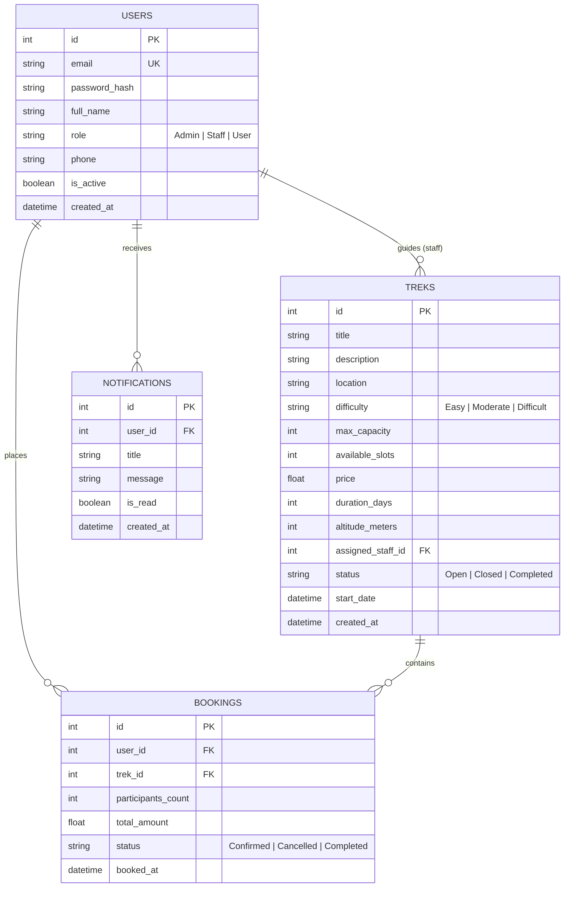

# 🏔️ Trekking Management Application (TMA) V2

A modern, full-stack expedition and trek management platform built with a high-performance **Flask REST API**, an interactive **Vue.js 3 Single Page Application (SPA)**, and an asynchronous task architecture powered by **Celery & Redis**.

---

## 🛠️ Tech Stacks

### Frontend
- **Framework:** Vue.js 3 (Composition API / CDN Reactive Architecture)
- **Routing:** Vue Router 4 (Client-side routing with authentication & role guards)
- **Styling & UI:** Bootstrap 5.3 + Bootstrap Icons (Responsive mountain adventure design system)
- **Architecture:** Single Page Application (SPA) served via a single Jinja2 entry point (`index.html`)

### Backend
- **Framework:** Flask 3.0+ (RESTful API architecture)
- **Database & ORM:** SQLite 3 with SQLAlchemy 2.0 & Flask-SQLAlchemy
- **Authentication:** Token-based API Authentication & Session Security (PBKDF2 SHA-256 password hashing)
- **Migrations:** Flask-Migrate (Alembic)

### Asynchronous & Caching
- **Task Queue & Scheduler:** Celery 5.3+ (Asynchronous email dispatch, PDF report exports, periodic notifications)
- **Message Broker & Cache:** Redis 7.0+ (Task queue broker, result backend, and API response caching)

---

## ✨ Features

### 1. Unified Authentication & Role-Based Access Control (RBAC)
- **Three Distinct User Roles:** `Admin`, `Staff` (Guides), and `User` (Trekkers).
- **Interactive Auth Flow:** Modal-driven Login & Registration with real-time password visibility toggle (Edge/Chrome native duplicate reveal suppressed).
- **Protected Routing:** Client-side navigation guards automatically redirect users to their designated dashboards.

### 2. Trekker (User) Experience
- **Consolidated Dashboard:** View enrolled treks, past expedition history, and open mountain routes all in one streamlined interface.
- **1-Click Modal Booking:** Select party size, view instantaneous price calculations, and receive immediate booking confirmation.
- **Capacity & Duplicate Protection:** Atomic slot deduction prevents overbooking and eliminates duplicate active registrations.
- **Trek History & Ratings:** Review completed expeditions and view difficulty metrics.

### 3. Mountain Guide (Staff) Console
- **Assigned Route Scoping:** Mountain guides only see expeditions assigned directly to them.
- **Live Roster Inspection:** Instant access to confirmed trekker rosters with contact details and team sizes.
- **Capacity Adjustments:** On-the-fly slot and status management based on real-time mountain conditions.

### 4. Administrator Command Center
- **System-Wide Analytics:** Live metrics tracking active treks, total participants, confirmed bookings, and registered users.
- **Staff Provisioning:** Secure administrative creation and management of guide accounts.
- **Trek Lifecycle Management:** Complete CRUD capabilities for managing routes, difficulties, altitudes, pricing, and assigned guides.
- **Audit & Review Workflow:** Approve, modify, open, close, or archive any expedition route.

### 5. Automated Background Jobs & Reporting
- **Asynchronous Notifications:** Automated welcome notifications, booking confirmation emails, and status alert dispatches via Celery.
- **Monthly Activity Summary:** Scheduled background jobs (Celery Beat) aggregate monthly trekking summaries.
- **Report Generation:** Background worker generation for downloadable participant and trek logs.

---

## 🔑 Default Admin Credentials

When the application is launched for the first time, the database and an administrator account are seeded automatically:

| Attribute | Value |
|:---|:---|
| **Role** | System Administrator (`Admin`) |
| **Email** | `admin@trekking.com` |
| **Password** | `Admin@123` |
| **Access Level** | Full Administrative Access |

> **Note:** Staff accounts are created directly by the Administrator through the Admin Console. Trekkers can register their own accounts through the Register modal.

---

## 🚀 Installation & Setup

### Prerequisites
- **Python:** 3.10 or higher
- **Redis:** Redis Server installed and running locally on port `6380` (or `6379`). Default configured to `6380` to avoid Windows Hyper-V port exclusion conflicts.

### 1. Clone the Repository
```bash
git clone https://github.com/24f1000739/Trekking-Management-Application-V2.git
cd Trekking-Management-Application-V2
```

### 2. Create and Activate a Virtual Environment
```bash
# Windows
python -m venv venv
venv\Scripts\activate

# macOS / Linux
python3 -m venv venv
source venv/bin/activate
```

### 3. Install Dependencies
```bash
pip install -r requirements.txt
```

### 4. Run the Application
You can run the application directly from the root directory or from the `backend/` directory:
```bash
# Option A: From root directory
python app.py

# Option B: From backend directory
cd backend
python app.py
```
The server will initialize the SQLite database (`instance/trekking_v2.db`), seed the default administrator account if not present, and start listening at:
👉 **`http://127.0.0.1:5000`**

### 5. Run Celery Worker & Beat (Optional for Background Jobs)
In separate terminal windows:
```bash
# Start Celery Worker (Windows)
celery -A backend.app.celery_app worker --loglevel=info -P solo

# Start Celery Beat (Periodic Scheduler)
celery -A backend.app.celery_app beat --loglevel=info
```

---

## 📁 Project Structure

The project strictly maintains separate **`frontend/`** and **`backend/`** directories:

```text
Trekking-Management-Application-V2/
│
├── backend/                          # Backend Application (Flask RESTful APIs)
│   ├── app/                          # Flask Application Package
│   │   ├── __init__.py               # App Factory, DB/Cache/Celery initialization
│   │   ├── api/                      # REST API endpoints (Auth, Admin, Staff, User, Notifications)
│   │   ├── models/                   # SQLAlchemy Database Models (User, Trek, Booking, Notification, etc.)
│   │   ├── routes/                   # Template & Route Handlers
│   │   ├── services/                 # Redis Cache Service & Invalidation Helpers
│   │   ├── tasks/                    # Celery Async Tasks (Daily reminders, monthly report, CSV export)
│   │   ├── celery_app.py             # Celery App Configuration
│   │   ├── decorators.py             # Role-Based Access Control (RBAC) Decorators
│   │   └── forms.py                  # Form Validation Helpers
│   │
│   ├── tests/                        # Automated Test Suite (20 unit/integration tests)
│   │   ├── __init__.py
│   │   ├── test_auth.py              # Authentication & RBAC tests
│   │   ├── test_treks.py             # Route management & slot validation
│   │   ├── test_bookings.py          # Booking workflow & duplicate checks
│   │   └── test_tasks.py             # Celery task validation tests
│   │
│   ├── app.py                        # Backend runner script
│   ├── config.py                     # Backend application configuration
│   └── requirements.txt              # Backend dependencies
│
├── frontend/                         # Frontend Application (Vue.js 3 SPA & Templates)
│   ├── static/                       # Static Assets
│   │   ├── css/style.css             # Responsive mountain UI styling
│   │   └── js/app.js                 # Vue 3 SPA components, router & reactive state
│   ├── templates/                    # HTML entry point and Jinja2 views
│   │   ├── index.html                # Single Page Application HTML mount point
│   │   ├── base.html                 # Base layout template
│   │   ├── dashboard_base.html       # Role dashboard layout
│   │   ├── admin/                    # Admin views & management forms
│   │   ├── auth/                     # Authentication & registration views
│   │   ├── staff/                    # Guide console & roster views
│   │   └── user/                     # Trekker dashboard, booking & history views
│   ├── components/                   # Modular Vue components
│   │   ├── auth/                     # Login & Register views
│   │   ├── admin/                    # Admin dashboard & controls
│   │   ├── staff/                    # Staff dashboard & roster
│   │   ├── user/                     # Trekker dashboard & booking flow
│   │   ├── notifications/            # Notification center & alerts
│   │   └── analytics/                # Chart.js analytics dashboard
│   ├── store/                        # Reactive auth and state management
│   ├── index.html                    # Single Page Application HTML entry point
│   ├── manifest.json                 # PWA Web App Manifest
│   └── service-worker.js             # PWA Service Worker
│
├── Project_Report.pdf                # Academic Project Report
├── requirements.txt                  # Python dependencies
├── app.py                            # Unified application runner
├── .gitignore                        # Git exclusion rules
└── README.md                         # Project documentation
```
└── README.md                         # Project documentation
```

---

## 🗄️ Database Schema

The database is built on a normalized relational model managed via SQLAlchemy:



---

## 🧪 Testing & Verification

Run the automated test suite to verify endpoints, validation rules, and authentication:

```bash
# Run tests with pytest
pytest backend/tests -v

# Or run standard unittest from root
python -m unittest discover -s backend/tests

# Or from backend directory
cd backend && python -m unittest discover -s tests
```
